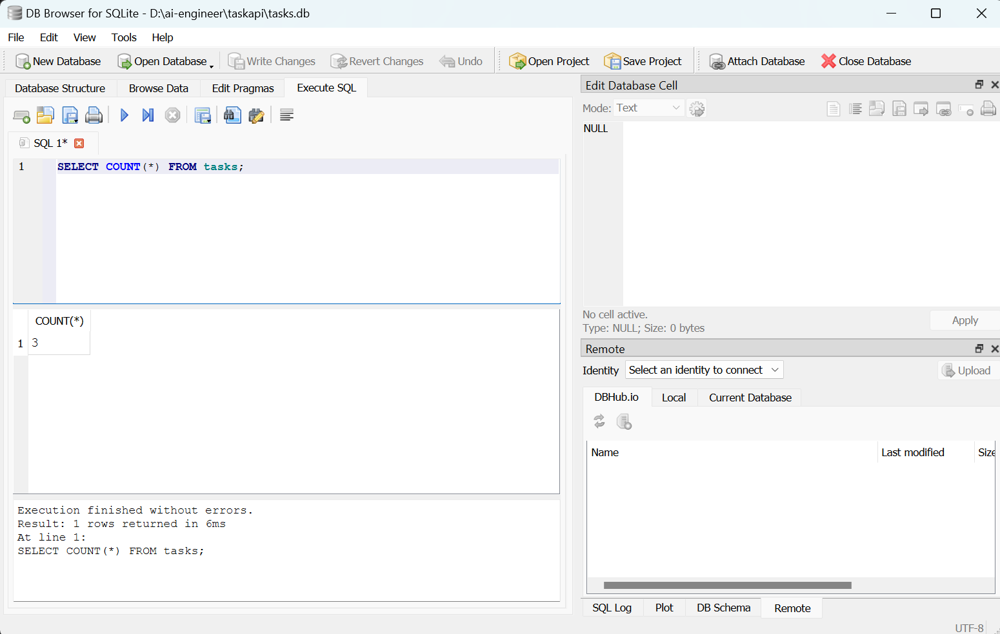
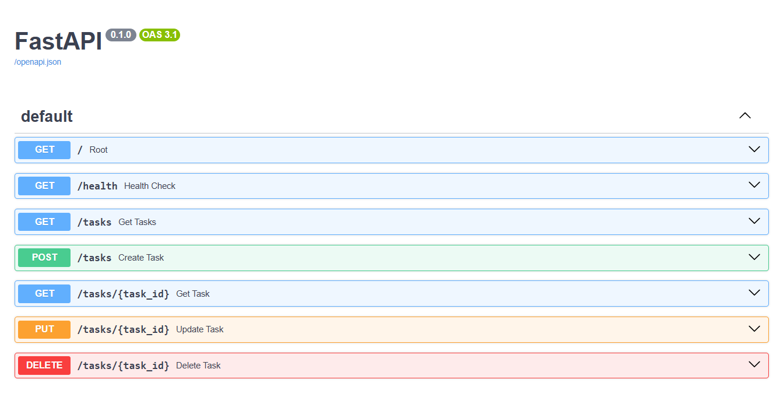

# Task API - FlyRank Backend Internship (Week 3 - Database Persistence)

A robust, persistent REST CRUD (Create, Read, Update, Delete) API built using Python, FastAPI, and SQLite3, featuring parameterized SQL queries, automatic database seeding, and interactive documentation via Swagger UI.

---

## 🛠️ How to Install and Run

Make sure you have Python 3.10+ installed on your system.

1. Clone the repository:
   git clone https://github.com/anum-codes/first-crud-api.git
   cd first-crud-api

2. Create and activate a virtual environment:
   python -m venv venv
   # On Windows:
   venv\Scripts\activate
   # On Mac/Linux:
   source venv/bin/activate

3. Install dependencies:
   pip install fastapi uvicorn pydantic

4. Run the server:
   uvicorn main:app --reload

5. Open your browser and navigate to http://localhost:8000/docs to view and test the Swagger UI interface.

---

## 🧭 API Endpoints

| HTTP Method | Endpoint Path | Description | Status Codes |
| :--- | :--- | :--- | :--- |
| GET | /tasks | Retrieves all tasks stored in the SQLite database | 200 OK |
| GET | /tasks/{id} | Retrieves a single specific task by its ID using parameterized queries | 200 OK, 404 Not Found |
| POST | /tasks | Creates a new task with validation and inserts it via SQL | 201 Created, 400 Bad Request |
| PUT | /tasks/{id} | Updates an existing task's title and completion status | 200 OK, 400 Bad Request, 404 Not Found |
| DELETE | /tasks/{id} | Deletes a task from the database by its ID | 204 No Content, 404 Not Found |

---

## 🗄️ Database Architecture & Persistence

### Why SQLite?
SQLite was chosen for this project because it is a serverless, zero-configuration database that lives entirely within a single file. It requires no separate database server installation, making it lightweight, fast, and ideal for local development and lightweight backend applications. Most importantly, it ensures persistence—meaning your task data outlives your program and remains intact across server restarts.

### Where the Database Lives
* File Name: tasks.db
* Location: Created automatically in the root directory of the project the first time the server starts up.
* Git Handling: The database file is typically included in .gitignore so that each fresh clone initializes its own clean database and seeds the initial examples automatically.

---

## 📊 Stage 4: Exploring SQLite by Hand

During Stage 4, the database was explored directly using DB Browser for SQLite to verify that the API and the database share a single source of truth.

Example SQL Query Run:
SELECT COUNT(*) FROM tasks;

* Result: It returned the total number of active rows present in the tasks table (e.g., 3 after the initial seeding).

---

## 📸 Screenshots

### 1. Database View (DB Browser for SQLite)
Here is a view of the tasks table open directly inside DB Browser for SQLite, showing the persisted rows:

### 2. Swagger UI
